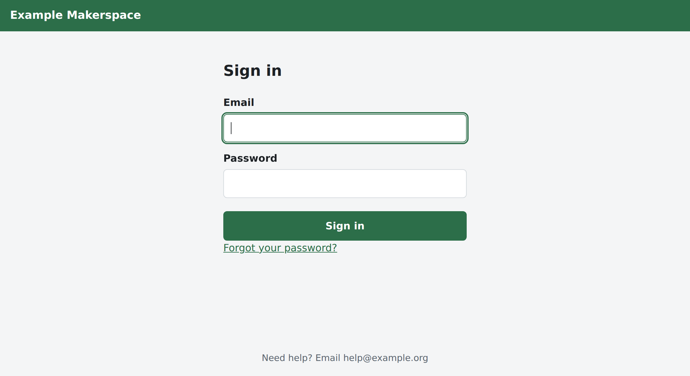
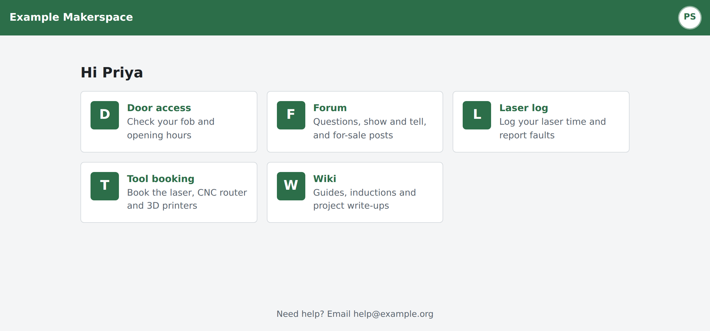
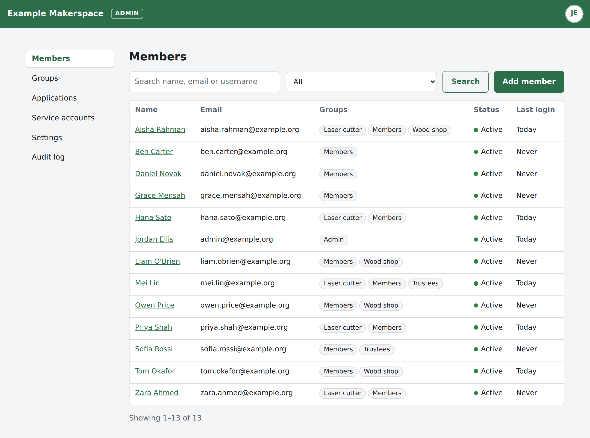

# Keywell

Keywell is a small, self-hosted sign-in server for clubs, makerspaces and other small organisations. Your members sign in once, on a page with your branding, and that sign-in works for your wiki and your other apps through OpenID Connect.

It is one Go binary with an embedded SQLite database. There is no Postgres, Redis or background worker to run alongside it.

| Sign-in page | A member's apps |
|---|---|
|  |  |



## Why Keywell

- **It's light.** On a test server it uses about 25 MB of memory when idle, and each sign-in briefly needs another 64 MB to check the password. The binary is 21 MB and the Docker image is 36 MB. Backing up means copying one database file, its config and a folder of icons.
- **Volunteers can run it.** The admin pages use plain language, and one idea controls access: groups decide who can use each app, who is an admin, and who must use two-step sign in.
- **You can move from Authentik without a fuss.** The importer copies members, groups and apps. Members keep their passwords, authenticator apps and recovery codes, and your apps see the same member IDs as before.

## Features

- **OpenID Connect provider:**
  - authorization code flow with PKCE, refresh tokens, and client credentials;
  - confidential apps and public ones such as browser apps;
  - discovery, userinfo, introspection, revocation and sign-out (`end_session_endpoint`);
  - RS256 signing keys you can rotate;
  - a `groups` claim.
- **Members:**
  - sign in with their email address;
  - branded sign-in, sign-out and password reset pages;
  - invitation and reset emails over SMTP;
  - a home page of tiles for the apps they can use;
  - an account page to change their name, password and two-step sign in.
- **Two-step sign in** with an authenticator app (TOTP) and recovery codes. Any group can require it.
- **Admin pages** for members, groups, apps and service accounts, with an audit log of who changed what. Members and groups can carry your own JSON metadata.
- **Admin API** with an OpenAPI document, for scripts and automation. Access uses read-only or full admin tokens.
- **Operations:** a Docker image and a systemd unit, Prometheus metrics on a separate private listener, and `/healthz`.
- **Protection:** sign-in rate limits, a list of common passwords people can't use, and two-step secrets and signing keys encrypted at rest.
- **Authentik importer**, safe to rerun, with a dry-run mode and a step-by-step [cutover guide](docs/cutover.md).

## What it doesn't do (yet)

- **No passkeys yet.** Passkeys are on the list.
- **No SAML, LDAP, or sign-in with Google, GitHub and the like.**
- **No self sign-up.** Admins add members, or a script does it through the API.
- **One process, one SQLite file.** There is no clustering. It is sized for hundreds of members, not millions.

## Status

Keywell was built to replace Authentik at one makerspace of about 120 members. Everything listed above works and is covered by tests, but it is not yet running in production anywhere. Try it on a test instance first, and please [open an issue](https://github.com/James-Smart/keywell/issues) when something doesn't work.

## Try it

You need Go 1.27 or later:

```sh
go install github.com/James-Smart/keywell/cmd/keywell@latest
keywell init --data-dir ./keywell-data --public-url http://localhost:8080 \
  --admin-email you@example.org --config ./keywell-data/keywell.yaml
keywell serve --config ./keywell-data/keywell.yaml
```

`init` asks for the first admin's password. It then writes the config file, creates the database and a token signing key, and makes `you@example.org` an admin.

Open <http://localhost:8080> and sign in. The Admin group requires two-step sign in, so you'll be asked to set it up with an authenticator app first. You don't need an email server to try it.

To use Docker instead, see [Docker](#docker) below with `http://localhost:8080` as the public URL.

## Running Keywell for real

Set `--public-url` to the HTTPS address members will use, for example `https://login.example.org`. Put Keywell behind a reverse proxy that handles HTTPS. `GET /healthz` answers `{"status":"ok","version":"..."}` for health checks.

Then list the proxy's address in `trusted_proxies`: for example `127.0.0.1/32` when the proxy runs on the same host, or `172.16.0.0/12` for Docker's default networks. Keywell believes `X-Forwarded-For` and `X-Forwarded-Proto` only from those addresses.

If the proxy is missing from the list, every member appears to come from the proxy's address. The sign-in limit of 50 failures per address per 15 minutes is then shared by everyone, so a few people mistyping their passwords lock the whole organisation out. Keywell logs a warning, `ignoring X-Forwarded-For from untrusted peer ...`, when it sees forwarded headers from an address it doesn't trust.

### Docker

`deploy/docker-compose.yml` runs Keywell from a small image with no shell. The data lives in a named volume, `keywell-data`, mounted at `/var/lib/keywell`. From a checkout, build the image, make the config and database once, then start it:

```sh
git clone https://github.com/James-Smart/keywell && cd keywell
docker compose -f deploy/docker-compose.yml build
docker compose -f deploy/docker-compose.yml run --rm keywell init --config /var/lib/keywell/keywell.yaml \
  --data-dir /var/lib/keywell --public-url https://login.example.org --admin-email you@example.org
docker compose -f deploy/docker-compose.yml up -d
```

- **Version:** to show one in `keywell version` and `/healthz`, set it when you build: `VERSION=$(git describe --always) docker compose -f deploy/docker-compose.yml build`.
- **Port:** published on `127.0.0.1:8080` only, so point your reverse proxy there.
- **Settings:** the image has no shell to edit the config file with, so set SMTP and other settings with `KEYWELL_` variables in the compose file's `environment:` section. The comments there show how.

### systemd

```sh
sudo useradd --system --home-dir /var/lib/keywell --shell /usr/sbin/nologin keywell
make build
sudo install -m 0755 keywell /usr/local/bin/keywell
sudo install -d -o root -g keywell -m 0750 /etc/keywell
sudo install -d -o keywell -g keywell -m 0750 /var/lib/keywell
sudo keywell init --config /etc/keywell/keywell.yaml --data-dir /var/lib/keywell \
  --public-url https://login.example.org --admin-email you@example.org
sudo chown root:keywell /etc/keywell/keywell.yaml
sudo chmod 0640 /etc/keywell/keywell.yaml
sudo chown -R keywell:keywell /var/lib/keywell
sudo cp deploy/keywell.service /etc/systemd/system/keywell.service
sudo systemctl daemon-reload
sudo systemctl enable --now keywell
```

The config file holds `encryption_key` and the SMTP password, so only root and the `keywell` group can read it.

### Configuration

`keywell.example.yaml` lists every setting with a short note, and `keywell init` writes your config file from it. Any setting can also be set with an environment variable: `KEYWELL_` plus the key path in capitals, for example `KEYWELL_SMTP_HOST`.

Keep `encryption_key` safe, and back it up with the database. It encrypts the two-step sign-in secrets and the signing keys, and without it they can't be read.

Keywell refuses to start if:

- `password.min_length` is below 10. The built-in list of common passwords only covers passwords of 10 or more characters.
- Any duration is 0 or negative.
- `tokens.access` or `tokens.id` is longer than 24h. A retired signing key keeps verifying tokens for only 24 hours.
- `tokens.refresh_absolute` is shorter than `tokens.refresh`.
- A `trusted_proxies` entry is not a CIDR range (`10.0.0.0/8`) or an IP address.
- `metrics.listen` is set but is not `host:port`, or uses port 0.

### Backups

A backup is three things: the database, `data_dir/icons` (the app icons admins uploaded) and the config file.

You need the config's `encryption_key` to read two-step sign-in secrets and signing keys from any backup. Without it, a copy of the database can't restore those, so keep the key somewhere separate from the database backups too.

You can back up the database while Keywell runs:

```sh
sqlite3 /var/lib/keywell/keywell.db ".backup '/backups/keywell.db'"
```

Under Docker, use a throwaway container with the volume mounted read-write (SQLite needs to write to its lock files, even to read), and copy the config and icons as well:

```sh
mkdir -p backups
docker run --rm -v keywell-data:/var/lib/keywell -v "$PWD/backups:/backups" alpine sh -c '
  apk add --no-cache sqlite >/dev/null &&
  sqlite3 /var/lib/keywell/keywell.db ".backup /backups/keywell.db" &&
  cp /var/lib/keywell/keywell.yaml /backups/ &&
  if [ -d /var/lib/keywell/icons ]; then cp -r /var/lib/keywell/icons /backups/; fi'
```

Or stop Keywell and copy `keywell.db` along with the other files.

### Metrics

Keywell can serve Prometheus metrics. Set `metrics.listen` (or `KEYWELL_METRICS_LISTEN`) to a `host:port` such as `127.0.0.1:9100`. It is off when empty. Metrics are served at `/metrics` on that address only.

The listener is separate on purpose. `/metrics` is never on the public listener, so a reverse proxy in front of Keywell can't expose it by accident. Bind it to a private address and let only your Prometheus server reach it.

There are four metric families:

- `keywell_build_info`: the running version.
- `keywell_http_requests_total`: requests answered, by status class (`1xx` to `5xx`).
- `keywell_logins_total`: sign-ins, by result (`success`, `failure`, `second_step_failure`). A correct password that still needs a second step counts only once that step is done.
- `keywell_tokens_issued_total`: tokens issued to apps, by grant (`authorization_code`, `refresh_token`, `client_credentials`).

To scrape it, add this to Prometheus:

```yaml
scrape_configs: [{job_name: keywell, static_configs: [{targets: ['127.0.0.1:9100']}]}]
```

## Connecting apps

### Your own app

Any OpenID Connect client library will work. Point it at the discovery document:

```
https://login.example.org/.well-known/openid-configuration
```

- **Grants:** `authorization_code`, `refresh_token`, and `client_credentials` (for confidential apps that act as a service account).
- **PKCE** with `S256`. Public clients such as browser apps must use it; confidential clients may.
- **CORS:** browser apps can call the token, userinfo and revocation endpoints directly. Keywell allows cross-origin requests from the origin of any registered redirect URI, without cookies. Discovery and the keys are readable from any origin.
- **Client authentication:** `client_secret_basic`, `client_secret_post`, or `none` for public clients.
- **Scopes:** `openid`, `profile`, `email`, `groups`, `offline_access`. The `groups` claim is a list of group names.
- **Signing:** ID tokens are signed with RS256. The public keys are at `/.well-known/jwks.json`.
- **Signing out:** send the member's browser to the `end_session_endpoint` (`/oauth/logout`) with `id_token_hint`, plus `post_logout_redirect_uri` if you registered one.

To register an app, open Admin pages, then Applications, then Add application:

1. Say whether the app keeps a secret.
2. List the addresses it sends members back to after sign-in.
3. Choose which groups may use it.

For an app that keeps a secret, copy the secret when it is shown. It is shown only once. If you lose it, make a new one from the app's page.

### MediaWiki

1. Install the [PluggableAuth](https://www.mediawiki.org/wiki/Extension:PluggableAuth) and [OpenID Connect](https://www.mediawiki.org/wiki/Extension:OpenID_Connect) extensions.
2. Register the wiki in Keywell as a confidential application, with the redirect URI `https://wiki.example.org/index.php/Special:PluggableAuthLogin` (use your wiki's own address).
3. Add this to `LocalSettings.php`. The app's page in Keywell has a Setup details panel with this snippet already filled in, apart from the secret.

```php
wfLoadExtension( 'PluggableAuth' );
wfLoadExtension( 'OpenIDConnect' );

$wgPluggableAuth_Config['Keywell'] = [
    'plugin' => 'OpenIDConnect',
    'data' => [
        'providerURL' => 'https://login.example.org',
        'clientID' => '…',
        'clientsecret' => '…',
        'scope' => [ 'openid', 'profile', 'email', 'groups' ],
    ],
];
```

`providerURL` is Keywell's `public_url`, with no trailing slash. The wiki takes the account name from `preferred_username`, along with `email` and `name`.

If the wiki's accounts came from Authentik, they are linked to Authentik's address, which changes when you switch. You must update the stored address in the wiki's `openid_connect` table with one `UPDATE`, as described in "The wiki" in [docs/cutover.md](docs/cutover.md#the-wiki).

`$wgOpenIDConnect_MigrateUsersByEmail = true;` is only a safety net. It matches by email only the wiki accounts that have no stored subject or issuer, not accounts already linked to Authentik.

## Moving from Authentik

`keywell import-authentik` reads an Authentik 2026.8 database and copies:

- members, groups and apps;
- password hashes, which Keywell checks at sign-in and then upgrades to Argon2id;
- authenticator apps and recovery codes.

Each app keeps the member IDs Authentik gave it. `--dry-run` shows what would change without saving anything, and you can rerun the import as often as you like until the switch.

[docs/cutover.md](docs/cutover.md) is a step-by-step checklist for the move, including the wiki.

## Admin pages

Admins manage Keywell at `/admin`. Signed-in admins reach it from the account menu in the top right.

You need to be in a group that has admin access. If any of your groups requires two-step sign in, you must have set it up, and Keywell asks for your code when you sign in. This is checked again on every admin page: if you join such a group after signing in, or one of your groups starts requiring it, the next admin page sends you to set up two-step sign in first.

The `Admin` group that `keywell init` makes has admin access and requires two-step sign in.

The sidebar has these entries:

- **Members:** add, find and edit members. You can also:
  - send an invitation or reset email;
  - set a password;
  - clear two-step sign in;
  - sign someone out everywhere;
  - disable or delete an account.
- **Groups**: make groups, choose which give admin access or require two-step sign in, and add or remove members.
- **Applications**: register apps, choose which groups may use them, show them on the members' home page, and see the details to set each one up.
- **Service accounts**: accounts for scripts and devices, with the API tokens they use.
- **Settings**: the branding, a button to test the email settings, and the signing keys.
- **Audit log**: who changed what and when, and sign-in activity.

## Admin API

Most of what you can do on the admin pages you can also do over HTTP, for scripts. Three things are on the admin pages only:

- sending a test email;
- making a new signing key (also `keywell rotate-keys`);
- uploading an app's icon. Over HTTP, set `icon_url` to an `https://` address instead.

To get a token:

1. Open Admin pages, then Service accounts, and add a service account.
2. On its page, make a token, choosing Read only or Full admin.
3. Copy the token when it is shown. It starts with `keywell_` and is shown only once.

Send the token as a bearer token:

```sh
curl -H "Authorization: Bearer keywell_…" https://login.example.org/api/v1/me
```

- **Read-only tokens** can only make `GET` requests. Full admin tokens can change things too.
- **Format:** requests and answers are JSON.
- **Limit:** each token may make 600 requests a minute.
- **Routes:** the OpenAPI document at `/api/v1/openapi.json` lists every route.

## Commands

Every command except `version` takes `--config PATH` (default `./keywell.yaml`). Run `keywell <command> -h` to see its flags.

| Command | What it does |
|---|---|
| `keywell init --public-url URL [--data-dir DIR] [--admin-email EMAIL]` | Writes a config file, sets up the database and a signing key, and adds the first admin. |
| `keywell serve` | Runs the web server. |
| `keywell create-admin --email EMAIL` | Adds someone to the Admin group, creating their account if they don't have one. |
| `keywell reset-password EMAIL` | Prints a link the member can use once, within an hour, to choose a new password. |
| `keywell rotate-keys [--retire-after 90d]` | Makes a new token signing key, and retires older keys that were replaced more than `--retire-after` ago. A running server picks up the change within 5 minutes. |
| `keywell import-authentik --from DSN [--dry-run] [--drop-key KEY]...` | Copies members, groups and apps from an Authentik database, with their passwords, two-step sign in and recovery codes. `--dry-run` shows what would be copied and saves nothing. Put the database password in the `PGPASSWORD` environment variable instead of in `--from` if you prefer. |
| `keywell version` | Prints the version. |

## Development

From a checkout, make a development instance once:

```sh
go run ./cmd/keywell init --data-dir ./dev-data --public-url http://localhost:8080 \
  --admin-email you@example.org --config ./dev-data/keywell.yaml
```

Then:

- `make run` runs the development server on that instance.
- `make test` runs the tests.
- `make build` builds a static `./keywell` binary.

The importer has extra tests that run against a real Authentik. `make authentik-up` starts one in Docker with test data, `make test-authentik` runs those tests, and `make authentik-down` stops it. See [dev/authentik/README.md](dev/authentik/README.md).

The code is laid out like this:

- `cmd/keywell` holds the commands.
- `internal/` holds the packages:
  - `web` for the pages;
  - `oidc` for the OpenID Connect endpoints;
  - `admin` for the rules behind the admin pages and API;
  - `api` for the admin API;
  - `store` for the SQLite database;
  - `importer` and `authentik` for the Authentik import.

Issues and pull requests are welcome. For anything large, please open an issue first so we can agree on the approach.

## Security

Please report security problems privately, through **Report a vulnerability** on the repository's [Security tab](https://github.com/James-Smart/keywell/security), not in a public issue.

## License

MIT. See [LICENSE](LICENSE).
